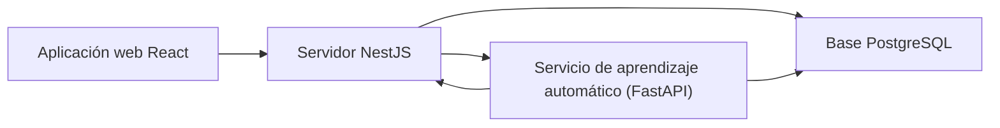

# Aplicación web de LANCELOT G11V

La aplicación web permite que el cuerpo técnico y los deportistas consulten y registren información en LANCELOT G11V. Presenta sus módulos y se comunica con el servidor mediante la API, que guarda y entrega los datos.

## Inicio rápido

Sigue estos pasos cuando Node.js esté instalado, exista `client/.env` y el servidor esté funcionando.

1. En PowerShell o Terminal, dentro de `client/`, inicia la página con **npm run dev**. Vite, la herramienta que sirve la página durante el desarrollo, mostrará una dirección local.
2. Copia en el navegador la dirección local que muestra Vite; el puerto habitual es 5173. Verás la página pública de inicio y el acceso a la plataforma.
3. Inicia sesión con una cuenta creada por el equipo administrador; no se documenta una cuenta de demostración.

## Antes de empezar

Necesitas la carpeta client/ del proyecto. La dirección para descargar el espacio de trabajo completo no está configurada; está **por confirmar**. Docker ejecuta programas aislados en contenedores. PostgreSQL es el programa que guarda los datos del proyecto.

| Programa | Versión mínima o recomendada | Descarga oficial |
|---|---|---|
| Node.js, ejecuta las herramientas que construyen la página | Vite 8 requiere Node 20.19+ o 22.12+; se recomienda Node 24 LTS. | [Descargar Node.js](https://nodejs.org/en/download) · [requisitos de Vite](https://vite.dev/guide/) |
| Docker Desktop, opcional para PostgreSQL del servidor | El proyecto no fija versión; instala la versión estable actual. | [Windows](https://docs.docker.com/desktop/setup/install/windows-install/) · [Mac](https://docs.docker.com/desktop/setup/install/mac-install/) · [Linux](https://docs.docker.com/desktop/setup/install/linux/) |
| Python, opcional para levantar aprendizaje automático | Python 3.12 o posterior; el Dockerfile de aprendizaje automático usa Python 3.12. | [Descargar Python](https://www.python.org/downloads/) |
| Git, descarga y organiza el código fuente | El proyecto no fija versión mínima; instala la versión estable actual. | [Descargar Git](https://git-scm.com/downloads/) |

Comprueba las instalaciones en PowerShell (Windows) o Terminal (Mac/Linux):

1. **node -v** — debe mostrar Node 20.19+ o 22.12+.
2. **npm -v** — muestra la versión de npm instalada con Node.js.
3. **docker --version** — solo si levantarás PostgreSQL con Docker.
4. Windows: **py -3.12 --version**; Mac/Linux: **python3 --version** — solo si también levantarás el servicio de aprendizaje automático.
5. **git --version** — muestra la versión de Git.

## Para usar el proyecto

### Instalación paso a paso

1. Abre PowerShell o Terminal en la raíz del espacio de trabajo y entra a la carpeta `client/` con el comando `cd client`. Debes quedar en `client/`.
2. Desde `client/`, instala las dependencias del archivo de bloqueo con **npm ci**. Al terminar, vuelve el indicador de la terminal sin errores.
3. Si no existe client/.env, copia la plantilla. En PowerShell: **Copy-Item .env.example .env**. En Mac/Linux: **cp .env.example .env**. No reemplaces un archivo existente.
4. Abre `client/.env` en un editor de texto y configura `VITE_API_URL`. Para el servidor local, usa el ejemplo siguiente.
5. Inicia la página desde client/ con **npm run dev**. La terminal mostrará la dirección local que debes copiar en el navegador; Vite usa normalmente el puerto 5173.

### Configuración: archivo .env

Una **variable de entorno** es un dato de configuración guardado fuera del código. `VITE_API_URL` es la única variable de entorno de esta aplicación. Las variables con prefijo `VITE_` se incluyen en los archivos que recibe el navegador; no pongas claves ni contraseñas ahí.

| Variable | Para qué sirve | Qué configurar en local |
|---|---|---|
| `VITE_API_URL` | Dirección del servidor seguida de la ruta `/api`. Si falta, la aplicación usa el valor local definido en el código. | Configura el origen local del servidor y agrega `/api`. |

La descripción de `VITE_API_URL` indica qué debe contener la variable; no es un valor para copiar. Conserva el formato de `.env.example` y usa el origen configurado para el backend. Guarda el archivo y reinicia `npm run dev`.

### Cómo ejecutarlo y comprobar que funciona

Mantén abierta la terminal donde corre Vite. Copia en el navegador la dirección local que muestra Vite; el puerto habitual es 5173. Debes ver la página inicial. Para entrar a los módulos necesitas una cuenta autorizada y el servidor disponible en la dirección indicada por `VITE_API_URL`.

La documentación del servidor local está en la ruta `/api/docs`, en el puerto 3000. La aplicación web no tiene un servidor de datos propio.

### Comandos disponibles

Ejecuta los comandos desde `client/`.

| Comando | Para qué sirve | Cuándo usarlo |
|---|---|---|
| npm ci | Instala las dependencias del archivo de bloqueo. | Primera instalación o después de cambiar dependencias. |
| npm run dev | Inicia la página en desarrollo. | Uso local. |
| npm run build | Comprueba TypeScript y genera el sitio en dist/. | Preparar una compilación. |
| npm run preview | Muestra localmente una compilación ya creada. | Revisar el resultado de la compilación. |
| npm test | Ejecuta pruebas Vitest una vez. | Revisar cambios. |
| npm run test:watch | Mantiene las pruebas activas. | Desarrollar pruebas. |
| npm run lint | Revisa estilo y comentarios. | Revisar cambios. |
| npm run lint:comments | Revisa la regla de comentarios por separado. | Comprobar esa convención. |
| npm run format | Aplica formato con Prettier. | Puede modificar archivos. |
| npm run format:check | Comprueba formato sin reescribir archivos. | Revisión antes de entregar. |

## Problemas comunes

1. **La terminal no reconoce node o npm.** Instala Node.js desde el enlace oficial y abre una terminal nueva.
2. **npm ci falla.** Comprueba que estás en client/, que Node cumple la versión indicada y que tienes conexión a Internet.
3. **La página no conecta con la API.** Confirma que el servidor esté iniciado y que `VITE_API_URL` termine en `/api`; después reinicia Vite.
4. **El navegador informa un error CORS.** CORS controla qué páginas pueden enviar solicitudes al servidor. En `backend/.env`, comprueba `CORS_ORIGIN` y usa el mismo origen local que muestra Vite (puerto 5173).
5. **El puerto 5173 está ocupado.** Vite informa que está en uso. Cierra la otra página de desarrollo; conserva 5173 porque el servidor permite ese origen.
6. **No puedes iniciar sesión.** No se documentan contraseñas de prueba ni cuentas demo. Pide al administrador una cuenta autorizada y comprueba que el servidor funcione.

## Para desarrolladores

**Interfaz web:** la parte de la aplicación que se ejecuta en el navegador. Este proyecto usa React 19, TypeScript ~6.0.2, Vite ^8.3.0, React Router ^7.18.4, Tailwind CSS ^4.3.3, Radix UI, TanStack Query ^5.104.0, Axios ^1.20.0, Zod ^4.6.5 y Recharts ^3.8.0. `package.json` no fija una versión mínima de Node; la indicada arriba corresponde a Vite.

### Arquitectura de carpetas y archivos

| Ruta | Función |
|---|---|
| package.json y package-lock.json | Comandos, librerías y versiones instaladas. |
| index.html | Página HTML que carga la aplicación. |
| vite.config.ts | Configura servidor de desarrollo y compilación web. |
| tsconfig.json, tsconfig.app.json y tsconfig.node.json | Opciones del compilador TypeScript. |
| eslint.config.js y .prettierrc.json | Reglas de revisión y formato del código. |
| components.json | Configuración de componentes visuales. |
| public/favicon.svg | Icono de la pestaña del navegador. |
| scripts/check-no-comments.mjs | Comprueba la regla de no agregar comentarios al código. |
| src/main.tsx | Punto de entrada del navegador. |
| src/App.tsx | Conecta sesión, tema, consultas y rutas. |
| src/routes/ | Define navegación, acceso por rol y carga de vistas. |
| src/views/ | Pantallas públicas, legales, de error y de la aplicación. views/app/ reúne inicio, club, deportistas, entrenamiento, salud, talento y análisis. |
| src/components/ | Componentes reutilizables, diseño, gráficos y piezas de cada módulo. |
| src/controllers/ y src/hooks/ | Coordinan pantallas y reúnen funciones reutilizables. |
| src/services/ | Solicitudes por recurso al backend. |
| src/lib/ | Cliente HTTP, origen de API, caché y claves de consultas. |
| src/context/ | Sesión, temporada/categoría, tema y ventanas modales. |
| src/schemas/ y src/types/ | Validación y tipos de datos. |
| src/constants/ y src/utils/ | roles, rutas, textos, etiquetas y funciones auxiliares. |
| src/styles/ y src/assets/ | Estilos, marca e imágenes. |
| src/test/ | Configuración y pruebas de la aplicación web. |

Archivos clave: `src/lib/apiClient.ts` añade la credencial y gestiona respuestas; `src/lib/env.ts` lee VITE_API_URL; `src/routes/appRoutes.tsx` define rutas privadas; `src/context/AuthProvider.tsx` mantiene la sesión.

### Pantallas y rutas

Las **rutas** son direcciones dentro de la página. El acceso depende del rol de la cuenta; el servidor también comprueba los permisos.

| Módulo | Ruta | Qué permite consultar |
|---|---|---|
| Inicio | /app/inicio | Resumen adaptado al rol. |
| Club | /app/club | Temporadas, categorías, competencias y partidos. |
| Deportistas | /app/deportistas | Directorio, ficha e informe, según permisos. |
| Entrenamiento | /app/entrenamiento | Sesiones, RPE (esfuerzo percibido por el deportista), partidos y cargas. |
| Salud | /app/salud | Alertas, lesiones, registros y consentimientos, según permisos. |
| Talento y progreso | /app/talento | Índices, rankings, alertas y planificación. |
| Análisis IA | /app/analisis | Estado del análisis, datos, calidad y disponibilidad de los datos. |

La página pública usa la ruta `/`. Los componentes están en `src/components/`; las rutas, en `src/routes/appRoutes.tsx` y `src/constants/navigation.ts`.

### Estado, sesión y conexión con la API

El **estado** guarda la información que la página necesita mientras se usa. TanStack Query conserva en una memoria temporal las respuestas del servidor. Contextos React guardan sesión, temporada, categoría y tema.

La **sesión** indica qué cuenta inició sesión. Un token es una credencial digital temporal. La aplicación web mantiene el token de acceso en memoria y guarda el token de renovación en `localStorage`, el almacenamiento del navegador que conserva datos entre visitas. Cuando una respuesta indica que el acceso venció, Axios intenta renovar la sesión.

El **cliente HTTP** envía y recibe solicitudes. `src/lib/apiClient.ts` configura Axios y agrega el token. `src/lib/env.ts` lee VITE_API_URL; las funciones de `src/services/` llaman al servidor. El flujo de código es vista → controlador → servicio → cliente HTTP.

Estructura: src/views/ contiene pantallas; src/components/ piezas visuales; src/routes/ rutas y protecciones; src/controllers/ coordinación de vistas; src/services/ solicitudes; src/context/ estado compartido; src/schemas/ validación y src/types/ estructuras de datos.

Hay 34 archivos de pruebas de Vitest en `src/`, incluidos flujos de interfaz y accesibilidad. No se ejecutaron durante esta documentación. La aplicación web no tiene Dockerfile ni docker-compose. El código no define una regla para clasificar cuentas de demostración. El equipo indica que el backend se despliega en Railway; la configuración del despliegue no está en el repositorio.

## Cómo se conecta con los otros proyectos

El navegador consulta al servidor. El servidor guarda datos en PostgreSQL y, cuando corresponde, consulta al servicio de aprendizaje automático. La aplicación web no se conecta directamente al servicio de aprendizaje automático ni a PostgreSQL.

